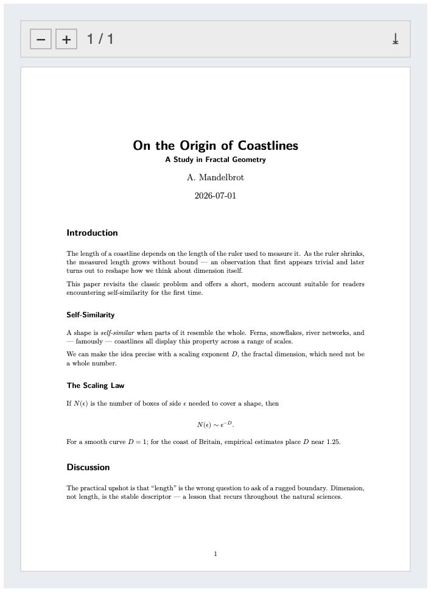

# embedpdf Extension For Quarto

[](https://github.com/jmgirard/embedpdf/releases)
[](LICENSE)
[](https://quarto.org)

Embed PDF files in Quarto HTML documents (including RevealJS presentations) — **and, unlike other approaches, they also render on mobile browsers.**

<p align="center">
  
</p>

On desktop, PDFs are shown with the browser's built-in viewer. On iPhone and iPad, the extension renders the PDF with [PDF.js](https://mozilla.github.io/pdf.js/), Mozilla's JavaScript PDF renderer (pictured above). It does the same in mobile browsers that cannot display embedded PDFs, such as Chrome on Android. The PDF.js viewer has a small toolbar for zooming, page tracking, and downloading.

- 📱 **Works on mobile**. On Android, `<object>`/`<iframe>` embeds and Quarto's native `` show a blank box or a download prompt. Users report that older iOS versions show only the first page.
- 🪶 **Light by default**. The ~1.7 MB PDF.js library is bundled, but a browser downloads it only for a PDF.js embed. Desktop visitors with a built-in PDF viewer fetch it only for `renderer=pdfjs` embeds.
- 🎛️ **One shortcode, sensible options** — size, borders, initial page, a download button, and per-document/project defaults.
- 🖥️ **Slides too** — renders inside RevealJS presentations.
- 📄 **Degrades gracefully** — falls back to a download link with JavaScript off, and to `\includepdf` (LaTeX) or a link in other output formats.

> [!NOTE]
>
> If you only care about desktop browsers, Quarto has native PDF embedding (``) that may suffice: [native.html](https://jmgirard.github.io/embedpdf/native.html)

## Installing

Run the following command in your terminal while in the same working directory as your Quarto document or project:

```bash
quarto add jmgirard/embedpdf
```

This will install the extension under the `_extensions` subdirectory.
If you're using version control, you will want to check in this directory.

## Using

To embed a PDF file in your document, use the `` shortcode. For example:

```




```

Remember to list the PDF file under `resources` in your YAML header so it gets copied to your output site:

```yaml
---
title: "My Document"
resources:
  - dummy.pdf
---
```

You can give a file name that holds a `%` with a bare `%`, as in `files/100%.pdf`. If two hex digits follow the `%`, the shortcode reads the three characters as an escape, as in a web address. A `%` written as `%25`, as in `files/100%25.pdf`, always works. In HTML and in the download link of other formats, the shortcode writes a bare `%` as `%25`. In PDF output it turns the escapes of printable ASCII characters back into those characters, so that LaTeX finds the file. It keeps the escapes of `\ { } # $ & ~ ^ _ " ,` as written.

### Options

| Option | Default | Description |
|---|---|---|
| `renderer` | `auto` | `auto` uses PDF.js on iPhone and iPad and in browsers with no built-in PDF viewer, such as Chrome on Android. Other browsers get their native viewer. `native` and `pdfjs` force one or the other. |
| `width` | | Width of the viewer (pixels or percent) |
| `height` | | Height of the viewer (pixels or percent) |
| `page` | `1` | Initial page to display. Desktop Safari 27.0.1 opens a native `<object>` at page 1. So in a desktop browser with a built-in PDF viewer, a native embed with a `page` over 1 is an `<iframe>` in two cases. The first is a PDF inlined in the page (a `data:` address), as on a self-contained page. The second is a PDF from the page's own origin (the same scheme, host, and port). Its server must answer a HEAD request within 5 s as `application/pdf`, not as an attachment, with no redirect to another origin. Otherwise the embed is an `<object>`, and desktop Safari opens it at page 1. These cases are a PDF from another origin, a failed request, and an answer that is not OK (such as 404 or 405). They are also another media type, an attachment, and a late answer. A PDF file on a page opened as a local file is one too, unless the PDF is inside the page. On 2026-10-20 such an `<iframe>` opened at its page in Chromium 155, Firefox 158 (both headless), and desktop Safari 27.0.1. An example of an `<iframe>` with no size at page load is one on a slide that RevealJS does not display at load. Such a slide is at least RevealJS's view distance (3 by default) from the first slide shown. Since version 1.2.8, the viewer gives such an `<iframe>` its PDF only after it has a size. Before 1.2.8 it opened at page 1 in Chromium and showed the pages shrunk in desktop Safari. |
| `toolbar` | `true` | Show the PDF.js toolbar (zoom, page indicator, download) |
| `border` | | Border width in pixels around the viewer |
| `class` | | Extra CSS class(es) for the viewer container |
| `button` | | Adds a download button with the given label below the viewer |

Defaults for any option can be set document- or project-wide under the `embedpdf` metadata key:

```yaml
embedpdf:
  renderer: pdfjs
  height: 600
```

### Other output formats

In LaTeX/PDF output, embedded PDFs are included page-by-page via the `pdfpages` package (`\includepdf`). In all other formats (docx, epub, gfm, typst, ...), a download link is emitted instead.

### Known limitations

- Self-contained HTML pages and RevealJS slides (`embed-resources: true`) show embeds inline from the one HTML file, with no PDF file beside it. Quarto puts the PDF in the page. If an embed uses `renderer=auto` or `renderer=pdfjs`, the page also carries PDF.js. The page then grows by the size of the two PDF.js files (1.7 MB for PDF.js 6.1.200). This was checked on 2026-10-18 in Chromium, with the page served over HTTP and opened as a local file. It was also checked in Safari in iOS 27.0 iPhone and iPad simulators. Self-contained RevealJS slides were checked in Chromium, and on 2026-10-19 in Safari in iOS 27.0 iPhone and iPad simulators. In desktop Safari only their native embeds were checked, as the next sentences say. A native embed of a self-contained HTML page shows the copy of the PDF inside the page. On 2026-10-19 the native embeds of `sample.pdf` on such a page were checked. The browsers were Chromium 155 and Firefox 158, both headless, and desktop Safari 27.0.1. On 2026-10-20 the native embeds on self-contained RevealJS slides were checked in the same way, at a RevealJS scale of 1. Other scales were not checked. The check showed each slide that holds a native embed in page order. These were slides 1, 2, and 4, counting the title slide as 0. The page was opened as a local file and over HTTP. Each embed showed the PDF as the same browser shows the PDF file. On 2026-10-20 an embed with `page=2`, which the viewer shows as an `<iframe>`, opened at page 2 in all three browsers. On the slides, that embed was on a slide that RevealJS did not display at load. The own PDF viewers of Chromium and desktop Safari save this copy under a name other than the PDF's file name. On 2026-10-20 its save button was checked on such a page, opened as a local file and over HTTP. The check covered `<object>` embeds and an `<iframe>` embed with `page=2`. Headless Chromium 155 saved `sample.pdf` under the id of its `blob:` URL, such as `03acb7cf-e9fe-49b4-b425-fa1a410248fe.pdf`. Desktop Safari 27.0.1 saved it as `Unknown.pdf`. Firefox 158 was not checked, because its viewer saved no file under the test tools. Its viewer reported the name `document.pdf`. Other addresses for the copy were tried in Chromium and Safari, and none saved it as `sample.pdf`. The `button` option adds a link whose download name is the PDF's file name. If a PDF.js embed in a self-contained document cannot show its PDF, it says so and gives a "Download the PDF" link. The link saves the PDF under its file name. If the browser cannot decode the PDF inside the page, the embed shows the message with no link, with any renderer. This was checked on 2026-10-19 in Chromium, where a click on the link saved the file. It was also checked in Safari in iOS 27.0 iPhone and iPad simulators, but there no file was saved. Only the link and the case with no link were checked. With JavaScript disabled, the download links in a self-contained document (the fallback link and the `button` link) point at the separate PDF file.
- With `renderer=native`, Safari on iPhone and iPad shows the PDF in its own viewer. This was checked on 2026-10-18 in iOS 27.0 iPhone and iPad simulators and an iOS 27.1 iPhone simulator. In the iOS 27.1 iPhone simulator, a swipe inside the embed reached every page. Users report that older iOS versions show only the first page ([#3](https://github.com/jmgirard/embedpdf/issues/3)). For this reason, `renderer=auto` uses PDF.js on iPhone and iPad.
- `renderer=auto` uses PDF.js on iPhone and iPad and in browsers with no built-in PDF viewer, such as Chrome on Android. `renderer=pdfjs` uses PDF.js everywhere. This item is about pages that are not self-contained. To show a PDF from another site, a PDF.js embed needs that site to allow the read with an `Access-Control-Allow-Origin` header. The checks used only the value `*`. Without the header, the embed shows "This PDF cannot be shown here." and an "Open the PDF" link. The link opens the PDF in a new tab. To avoid this, put the PDF in your project. This was checked on 2026-10-18 in Chromium with an emulated iPhone and an emulated Android phone, not on an Android device. iPhone and iPad were checked only in Safari in iOS 27.0 simulators. The local test site sent no header on 2026-10-18 and sent `*` on 2026-10-19. On 2026-10-18, `curl -I` showed `access-control-allow-origin: *` for `https://jmgirard.github.io/embedpdf/sample.pdf`. On the same date, `https://nbviewer.org/github/jhelvy/cv/blob/main/cv-jph.pdf` sent no such header. Safari refuses the PDF.js read of an address that a native embed on the page loaded, even with the header. A native embed is one with `renderer=native`, or with `renderer=auto` in a desktop browser that has a built-in PDF viewer. A native embed and a PDF.js embed can show one PDF from another site. In that case the PDF.js embed reads the PDF at the same address with `embedpdf=pdfjs` added to its query. It does so in every browser, not only in Safari. The site must answer that address with the same PDF, which was checked only on the local test servers. This case was checked on 2026-10-19 in Safari in iOS 27.0 iPhone and iPad simulators, in desktop Safari 27.0.1, and in Chromium. A PDF of 14 pages and 171 KB then loaded in parts (by byte ranges). This was checked in the iOS simulators, and in Chromium with an emulated iPhone and Android phone. Desktop Safari was not checked for byte ranges. The guide's [PDFs on another site](https://jmgirard.github.io/embedpdf/example.html#pdfs-on-another-site) section has the details.
- The viewer requires JavaScript; with it disabled, embeds become a download link.
- The PDF.js canvas viewer does not yet support text selection or search; use the native renderer on desktop (the default) if you need those.
- For screen readers, a PDF.js embed is a group named "PDF: " and the PDF's file name, for example "PDF: sample.pdf". The file name is the last part of the PDF's path. When the path does not end in `.pdf`, the last part of the first query value that does is used, so `download.php?file=a.pdf` gives "PDF: a.pdf". If neither the path nor a query value ends in `.pdf` and the address has a query, the name is "PDF". An address that names no file, such as a bare site address, also gives the name "PDF". When two or more embeds on a page get the same name, each one gets a number, for example "PDF: sample.pdf (2 of 3)". Native embeds also get names, as the end of this item says, and the count takes PDF.js embeds and native embeds together. Each page of the embed is a group labeled "Page 1 of 2" and so on. Each page carries its text in a hidden block. The page image is hidden from screen readers. The text cannot be selected on the page. Each toolbar control (zoom out, zoom in, download) has one name, which is also its tooltip. The page indicator shows "1 / 2", and screen readers read "Page 1 of 2". This was checked on 2026-10-19 in Chromium's accessibility tree. In desktop Safari 27.0.1, only the embed's name, the toolbar controls' names, and the page indicator were checked, through WebDriver. In Safari in iOS 27.0 iPhone and iPad simulators, the page's attributes and text were checked, including the page indicator's text. On 2026-10-20, the names that Safari gives screen readers were also checked there, through Web Inspector, on the test pages `example.html` and `page_test.html`. These were the embed's name, the toolbar controls' names, and the page indicator, read with the role heading. It was not checked with a screen reader such as VoiceOver or TalkBack. A native embed, which shows the browser's own PDF viewer, gets the same name on its `<object>`, for example "PDF: sample.pdf (1 of 11)". This name was checked on 2026-10-19 in Chromium's accessibility tree and through WebDriver in desktop Safari 27.0.1. In Safari in iOS 27.0 iPhone and iPad simulators, it was checked in the page's attributes, and on 2026-10-20 through Web Inspector. An `<iframe>` embed gets the name on its `<iframe>`. On 2026-10-20 this was checked in Chromium's accessibility tree and through WebDriver in desktop Safari 27.0.1. The names inside the browser's own PDF viewer were not checked.

## Guides

Here is a more in-depth guide to using the embedpdf extension: [example.html](https://jmgirard.github.io/embedpdf/example.html).
